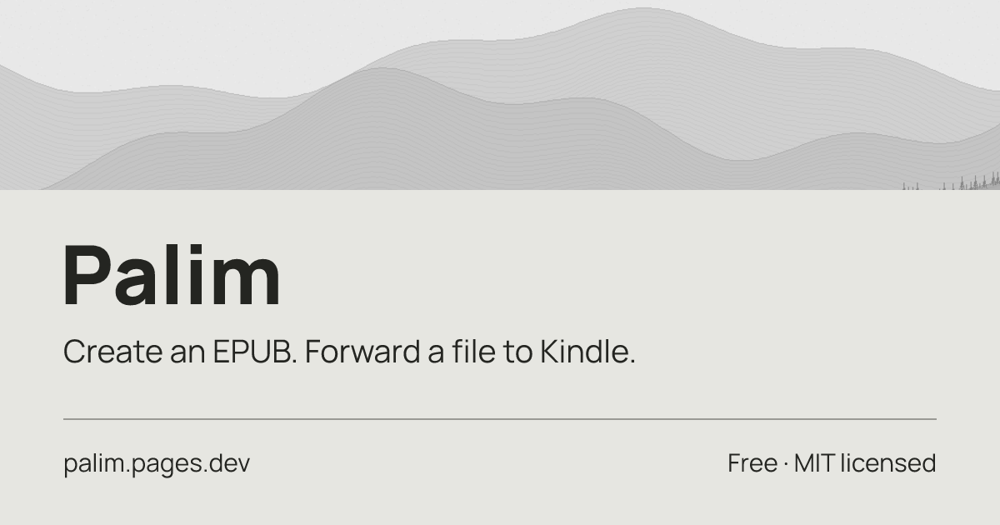

# Palim

Make an EPUB from your writing, or send an existing EPUB or PDF to your Kindle unchanged.
Use Palim in your browser or with your agent. The software is free and MIT-licensed.

[](https://github.com/timc0y/palim/actions/workflows/checks.yml)
[](LICENSE)

[Website](https://palim.pages.dev/) · [Studio](https://palim.pages.dev/app) ·
[Connect an agent](#connect-an-agent) ·
[Self-host](#self-host-on-cloudflare)



Independent open-source software by [Tim Coy](https://timcoy.uk). Not affiliated with Amazon or
Kindle.

## Create a book or forward a file

- **[Create a book](https://palim.pages.dev/app#create-panel).** Enter a title and write or paste plain text or Markdown. Palim builds an EPUB with a
  cover and table of contents. Preview it in the browser or download it to read. Your agent can
  also supply illustrations, diagrams, charts and source notes.
- **[Forward a file](https://palim.pages.dev/app#upload-panel).** Choose an EPUB or PDF and select **Upload to Shelf**. When you’re ready to send,
  select **Send**, check the Kindle address and confirm. You can also forward a file through your agent.
  The emailed attachment contains the exact bytes you uploaded.

You can create and download a book before setting up a Kindle address. Files expire after 24 hours,
private download links after 15 minutes, and delivery receipts after 35 days. If a link expires
while the file is still on your Shelf, open the file there for a fresh link.

## Try the publisher locally

Use Node 22.16 or later.

```sh
git clone https://github.com/timc0y/palim.git
cd palim
npm ci
npm run check
cp .dev.vars.example .dev.vars
npm run build    # bundle Worker and public assets without deploying
npx wrangler d1 migrations apply palim --local
npm run dev      # local HTTPS site at https://localhost:8787
```

## Connect an agent

Connect your client using the instructions below and sign in. Your agent writes the manuscript.
Palim turns it into a book without running another AI model.

> Turn this conversation into a short EPUB. Give me the preview and download links.

When you want to send a file, save a Kindle address in Studio and approve your personal Palim
sender in Amazon’s Personal Document Settings. You can save up to five addresses and choose a
default. Sending is a separate action.

### ChatGPT

1. Open [ChatGPT Plugins](https://chatgpt.com/plugins), select **+ → Add custom MCP server**, and
   name it Palim.
2. Enter `https://palim.pages.dev/mcp`, choose OAuth, review the connection warning, and
   select **Create as a plugin**.
3. Complete Palim sign-in in the browser and approve consent. Start a new conversation with Palim
   enabled.

Availability and workspace policies depend on your account. This is a custom connection, not a
public-directory listing. Do not paste inbox codes or tokens into chat.

### Codex

With a current Codex client:

```sh
codex plugin marketplace add timc0y/palim --ref main
codex plugin add palim@palim
```

The first command registers this repository’s marketplace; the second installs the single plugin
from it. Complete the client’s OAuth connection and sign-in when requested. Do not add a duplicate
Palim connection. Client discovery and actual authenticated use are separate checks; see
[verification](docs/verification.md).

[Download the complete plugin ZIP](https://palim.pages.dev/palim-plugin.zip) ·
[SHA-256](https://palim.pages.dev/palim-plugin.sha256)

The archive is an inspectable Codex compatibility package containing no credentials. Normal
builds and deployments derive its endpoint, website and privacy links from the Worker `ORIGIN`.
To build a bundle without deploying, pass that same canonical origin explicitly:

```sh
npm run plugin -- https://your-real-palim-host
```

### Claude, Cursor & other MCP clients

For any client that accepts a streamable HTTP MCP URL and an `Authorization: Bearer` header:

1. Sign in to the [Palim studio](https://palim.pages.dev/app).
2. Open **Settings → Agent → Personal MCP token**, select **Create token**, and copy it once.
3. Point your client at `https://palim.pages.dev/mcp` with header
   `Authorization: Bearer <your token>`.

The personal token can read, create, and send books on your account. Store it only in your client’s
private credentials. Replacing or revoking the token in Settings disconnects every client using it.
Note: personal MCP tokens require D1 migration `0008-mcp-token.sql` and the matching Worker
deployment on the hosted service; see [verification](docs/verification.md) for current deployed
status. Manage connected OAuth agents in **Settings → Agent**, and delete your account any time in
**Settings → Account**.

### Available MCP tools

| Tool                | Responsibility                                                                                                  |
| ------------------- | --------------------------------------------------------------------------------------------------------------- |
| `get_guide`         | Read the canonical authoring/import guide; no data changes or mail.                                             |
| `get_artifact`      | Refresh private links to an owned, unexpired file without recreating or sending it.                             |
| `import_image`      | Import a client-provided PNG/JPEG for an illustrated book; no mail.                                             |
| `create_book`       | Publish the agent’s supplied manuscript. A draft never sends email.                                             |
| `list_destinations` | Read owned Kindle labels, IDs and the default; omits the email field. Requires sending permission; never sends. |
| `send_document`     | Deliver an owned artifact or supported host file, unchanged.                                                    |
| `get_delivery`      | Read submission evidence without resending.                                                                     |

Object results include `structuredContent` alongside matching JSON text. Agents can select a saved
label with `list_destinations`, then pass its ID to `send_document` (omitting it uses the account
default). Use `get_artifact` when a 15-minute signed link expires; `linksExpireAt` is separate from
the file’s 24-hour `expiresAt` and never extends retention or consumes an allowance.

## Self-host on Cloudflare

Palim runs on a Cloudflare Workers Paid account with one Worker, D1, private R2, KV, outbound Email
Sending, and a thin Pages service-binding front door. Replace the maintainer identifiers in
[`wrangler.jsonc`](wrangler.jsonc) and [`pages/wrangler.jsonc`](pages/wrangler.jsonc), configure
`AUTH_SECRET` and `SIGNING_SECRET`, apply D1 migrations (`0001`–`0008`), and deploy.

Full instructions, provider setup, R2 lifecycle rules, and operator duties live in
[deployment](docs/deployment.md).

## Original means original

Forwarding never calls the publisher. The service inspects bounded metadata, stores the original
bytes, verifies their SHA-256 hash, and attaches those same bytes. It does not repair, recompress,
watermark, rewrite, or change embedded metadata. Amazon may convert what it imports; Palim cannot
control that representation, replace an existing personal document, transfer highlights, or read your
library. See [architecture](docs/architecture.md).

## Limits worth knowing

Uploads are capped at 20 MiB; Cloudflare’s total email limit is 25 MiB including MIME encoding
and headers, so some valid uploads are download-only. A generated book holds at most 24 chapters and 12
figures, with PNG/JPEG assets capped at four million pixels each and 8 MiB per book. Files expire
after 24 hours and download links after 15 minutes. Hosted accounts default to 2 creation attempts,
6 uploads, and 3 email submissions per UTC day, with shared daily and monthly ceilings.

There is no server-side writing model and no repository crawler. Read the full statement in
[privacy and limits](https://palim.pages.dev/privacy).

## Status & verification

The hosted instance at `https://palim.pages.dev` serves the deployment recorded in
[verification](docs/verification.md). Any subsequent unreleased changes on `main` are noted there
separately until deployed.

CI runs TypeScript, SQLite-backed behavioural contracts, local workerd/D1/R2/OAuth/MCP/Pages
proofs, a production dependency audit, Chromium layout checks, and checksum-pinned EPUBCheck.
Amazon import and physical Kindle rendering are not exercised in CI; `docs/verification.md` states
the exact proof boundary.

## Development

```sh
npm run check         # tsc --noEmit, JS syntax checks, and behavioural test suite
npm run format:check  # Prettier formatting check
npm run build         # build the social card, plugin ZIP and Worker bundle
```

## Repository map

- `src/book.ts`, `figures.ts`, `archive.ts` — EPUB creation, artwork, and original-file inspection.
- `src/book-styles.ts` — shared EPUB and browser-preview styles, also used by the EPUB validation fixture.
- `src/service.ts`, `store.ts`, `mail.ts` — publishing, ownership, allowances, and delivery.
- `src/index.ts`, `routes.ts`, `mcp.ts`, `auth.ts`, `login.ts`, `personal-token.ts` — HTTP, MCP,
  OAuth, email OTP identity, and personal bearer tokens.
- `public/` — landing page, studio, privacy page, self-hosted fonts and desktop artwork.
- `pages/` — the thin Pages front door; `migrations/` — the D1 schema (`0001`–`0008`).
- `test/`, `scripts/`, `examples/` — behavioural checks, local runtime proofs, and EPUB validation fixtures.
- `plugins/palim/` — the optional Codex connection package.

[Architecture](docs/architecture.md) · [Authoring](docs/authoring.md) ·
[Deployment](docs/deployment.md) · [Verification](docs/verification.md) · [Design](DESIGN.md) ·
[Licences](THIRD_PARTY.md) · [Contributing](CONTRIBUTING.md) · [Security](SECURITY.md)

## Connection troubleshooting

Use the canonical Pages address (`https://palim.pages.dev`). If a saved consent screen
mentions `ORIGIN`, start the connection again from the client instead of replaying that form. Never
paste codes, cookies, or tokens into an issue.
